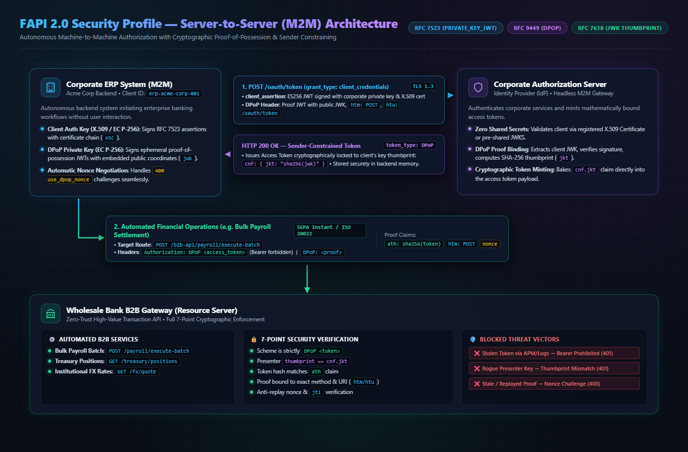

# Beyond mTLS: Why FAPI 2.0 and DPoP Are the Future of Corporate Open Banking

> *Moving enterprise B2B banking security from fragile transport pipes (mTLS) to resilient application-layer cryptography using RFC 7523, RFC 9449, and the OpenID FAPI 2.0 Security Profile.*

---

## 1. The Corporate Open Banking Dilemma

When Open Banking first emerged under PSD2 and UK Open Banking regulations, the primary focus was on retail, consumer-to-business (C2B) use cases: an individual granting a FinTech app permission to view checking accounts or make payments through browser redirects and mobile biometric handshakes.

However, the real volume in financial services resides in **Corporate and Wholesale Banking**:
* Multi-million-euro automated treasury liquidity sweeps
* High-volume automated bulk payroll processing (SEPA Instant / ISO 20022)
* Dynamic FX hedging executed directly by ERP systems (SAP, Oracle, NetSuite)

In these **Server-to-Server (M2M)** architectures, there is no end-user sitting in front of a screen to approve authorizations or respond to Push OTPs. Machines communicate autonomously with bank gateways. 

In traditional OAuth 2.0 (RFC 6749 Client Credentials Grant), this interaction relies on static shared secrets (`client_id` + `client_secret`) returning **Bearer tokens**. In high-value banking, this model introduces fatal vulnerabilities:
* **Token Exfiltration**: If a Bearer token leaks into logs, APM systems, or memory dumps, an attacker can replay it from anywhere without restrictions.
* **Shared Secret Sprawl**: Static secrets inevitably end up in source code, CI/CD pipelines, or configuration files.
* **Lack of Cryptographic Non-Repudiation**: A shared secret cannot legally prove who originated a specific high-value transaction.

---

## 2. The Traditional Fix: Why Mutual TLS (mTLS) Is Hurting Enterprises

To prevent credential leakage and enforce sender-constraining, banking standards initially leaned on **Mutual TLS (mTLS)** (RFC 8705). 

While cryptographically robust, mTLS imposes severe operational hurdles in modern cloud environments:

### A. The Reverse Proxy & Ingress Bottleneck
In modern cloud architectures (Kubernetes, AWS ALB, Cloudflare, Envoy, Kong), TLS almost always terminates at edge ingress controllers. Passing client certificate details downstream requires brittle header injection (`X-Forwarded-Client-Cert`), complex certificate passthrough rules, and customized network pipelines.

### B. The Death of Dual-EKU Certificates (CA/Browser Forum Mandate)
Historically, enterprises simplified certificate management by deploying certificates with dual Extended Key Usage (EKU) flags: both **Server Authentication** (`serverAuth`) and **Client Authentication** (`clientAuth`). 

Under recent **CA/Browser Forum Baseline Requirements**, public Certificate Authorities (CAs) are prohibited from issuing dual-EKU certificates. Furthermore, public certificate validity is being aggressively shortened (moving toward 90–100 day lifecycles). Organizations are forced to maintain separate, complex PKI pipelines, significantly increasing certificate rotation overhead and the risk of costly production outages.

### C. Edge Protection & CDN Limitations
Major WAFs and CDNs either charge exorbitant enterprise fees or restrict end-to-end mTLS client renegotiation, forcing banks to either compromise on edge DDoS protection or build complex network topologies.

---

## 3. Enter FAPI 2.0: Moving Cryptography to the Application Layer

The **Financial-Grade API (FAPI 2.0)** Security Profile by the OpenID Foundation resolves this architectural dilemma. Instead of tethering security to the network transport pipe (Layer 4/TLS), FAPI 2.0 lifts authentication and sender-constraining directly into the **Application Layer (Layer 7)**.

### The Three Core Pillars of FAPI 2.0 M2M:

1. **RFC 7523 (`private_key_jwt`) Client Authentication**:
   Shared client secrets are eliminated. The ERP authenticates at `/oauth/token` by digitally signing a JWT assertion with its private EC key (`ES256`). The bank validates this signature using the client's public JWKS or X.509 certificate embedded in the `x5c` header. No secrets ever cross the wire.
2. **RFC 9449 (DPoP — Demonstrating Proof-of-Possession)**:
   Access tokens are sender-constrained rather than Bearer tokens. When requesting a token, the client presents an ephemeral DPoP public key. The Authorization Server binds the SHA-256 thumbprint of that key into the token's payload (`cnf: { jkt: "<thumbprint>" }`). On every API call, the client generates a fresh DPoP proof. The bank verifies that the presenter holds the private key matching `cnf.jkt` and checks the Access Token Hash (`ath`). Even if exfiltrated, **the token is completely useless to an attacker**.
3. **RFC 9449 (§8) DPoP Nonce Negotiation**:
   The bank gateway can challenge requests with an `HTTP 400 use_dpop_nonce` error. The client immediately refreshes its proof with the server-supplied nonce, preventing offline pre-computed signatures and replay attacks.

---

## 4. Hands-On Lab & GitHub Reference

To explore a complete, runnable reference implementation of this architecture built with **zero external dependencies** (using native Node.js `node:crypto` and `node:http`), including an interactive dark-mode dashboard and a ready-to-run Bruno API collection:

👉 **GitHub Repository**: [https://github.com/dvitali/fapi2.0-demo](https://github.com/dvitali/fapi2.0-demo)

The repository includes:
* An Authorization Server issuing RFC 9449 sender-constrained tokens.
* A Wholesale Corporate Bank Gateway executing 7-point cryptographic security audits.
* Automated attack simulators demonstrating how stolen Bearer tokens and rogue keys are blocked in real time.
* An 8-step Bruno collection for end-to-end testing with pre-request cryptographic scripts.

---

## 5. Architecture Comparison: mTLS vs. FAPI 2.0 DPoP

| Security Dimension | Legacy Mutual TLS (mTLS) | FAPI 2.0 (DPoP + Private Key JWT) |
| :--- | :--- | :--- |
| **OSI Security Layer** | Transport Layer (Layer 4 / TLS) | Application Layer (Layer 7 / HTTP) |
| **Edge & Proxy Termination** | Breaks when TLS terminates at CDN / WAF / Ingress | Survives any reverse proxy or API gateway |
| **CA / EKU Mandates** | Constrained by CA/B Forum Dual-EKU ban | Independent of CA constraints (JWK / `x5c`) |
| **Secret Management** | Frequently paired with static shared secrets | Zero shared secrets (`private_key_jwt` ES256) |
| **Token Theft Impact** | Vulnerable if access token is Bearer | Token is cryptographically inert without private DPoP key |
| **Operational Overhead** | High (PKI distribution, proxy passthrough, ingress certs) | Low (Standard JSON payloads, HTTP headers, Web Crypto) |

---

## 6. Reference Guide: Demystifying Certificates in Banking (QSealC vs. QWAC vs. Standard SSL vs. DPoP)

In European Open Banking and corporate treasury architectures (under **eIDAS Regulation EU 910/2014**, **ETSI TS 119 495**, and **Berlin Group openFinance**), confusion often arises regarding the distinct roles of **QWAC**, **QSealC**, **Standard SSL/TLS**, and **DPoP**.

### The Intuitive Analogy

| Technology | Real-World Analogy | What It Actually Protects |
| :--- | :--- | :--- |
| **Standard SSL / TLS** | A generic tinted armored vehicle. | Encrypts data in transit from eavesdroppers; anyone with a domain can obtain one. |
| **QWAC** (*Qualified Web Auth Cert*) | An armored vehicle driven by a **vetted diplomatic courier**. | Authenticates the organization establishing the transport pipe during the TLS handshake. |
| **QSealC** (*Qualified Electronic Seal*) | The **notarized, tamper-evident corporate signature and wax seal** on the contract inside. | Guarantees legal non-repudiation and integrity for the payload itself, even after the vehicle arrives and TLS terminates. |
| **DPoP** (*RFC 9449 Proof*) | A **single-use security badge** generated dynamically for the current session. | Cryptographically binds the access token to the client's session key, preventing theft and replay. |

### Comparative Architecture Matrix

| Feature | Standard SSL / TLS | QWAC (Qualified Web Auth) | QSealC (Qualified Electronic Seal) | DPoP (RFC 9449) |
| :--- | :--- | :--- | :--- | :--- |
| **OSI Layer** | **Layer 4** (Transport / TLS) | **Layer 4** (Transport / TLS) | **Layer 7** (Application / Payload) | **Layer 7** (HTTP Header) |
| **Primary Purpose** | Wire encryption in transit | Mutual channel authentication (mTLS) | Payload non-repudiation & integrity | Sender-constraining access tokens |
| **Key Usage / EKU** | `serverAuth`, `clientAuth` | `serverAuth`, `clientAuth` | `digitalSignature`, `nonRepudiation` | None (ephemeral keypair) |
| **Trust Anchor** | Public CAs (Let's Encrypt, DigiCert) | Qualified Trust Service Provider (QTSP) | Qualified Trust Service Provider (QTSP) | Ephemeral client key (no CA required) |
| **Survives TLS Termination?** | ❌ No | ❌ **No** (ends at WAF / ALB) | ✅ **Yes** (travels inside signed message) | ✅ **Yes** (travels in HTTP header) |
| **Legal Status (eIDAS)** | None | Proves entity operating endpoint | **Legal presumption of integrity** (Art. 35) | Technical proof-of-possession |
| **Typical Banking Usage** | Public HTTPS browsing | Bank-to-ERP mTLS transport tunnel | `client_assertion` (`x5c`), ISO 20022 signatures | `DPoP` proof header & `cnf.jkt` claim |

### Deep Dive: Transport Layer (QWAC) vs. Application Layer (QSealC)

The critical limitation of relying solely on **QWAC** is **TLS termination at enterprise perimeters**:
1. When an ERP connects via mTLS, the cryptographic protection ceases at the bank's external reverse proxy or CDN edge.
2. Between the gateway and core accounting systems, the payload travels through internal microservices and message queues.
3. If an internal component or rogue process tampers with payment details, the bank has **no cryptographic evidence** proving whether data was modified in flight or arrived corrupted from the client.
4. **QSealC solves this at Layer 7**: By signing the payload directly with a corporate electronic seal (embedded via `x5c` or signed XML/JSON), the signature remains intact end-to-end and can be archived in the bank's permanent audit ledger.

### How They Fit Together in FAPI 2.0 B2B Banking

In a modern corporate banking architecture:
* **Client Identity at `/oauth/token` (RFC 7523 + QSealC)**: The corporate ERP signs its assertion using its enterprise certificate / QSealC in `x5c`. The bank's Authorization Server verifies corporate identity without shared secrets.
* **Access Token Protection (DPoP)**: The ERP manages a lightweight, ephemeral EC keypair (`P-256`) to sign DPoP proofs. The token is bound to `cnf.jkt`. DPoP does *not* require complex CA certificates; it is an agile Layer 7 mechanism dedicated to eliminating Bearer token theft.
* **Corporate Seal Authorization**: For high-volume headless transactions (such as a €1,500,000 payroll batch), interactive end-user SCA is unfeasible. Under PSD2 RTS Article 32, a qualified corporate electronic seal (QSealC) serves as the regulatory-compliant equivalent of Strong Customer Authentication.

---

## 7. Conclusion: The Path Forward for B2B Banking

The era of relying exclusively on transport-level mutual TLS for enterprise financial services is drawing to a close. As cloud-native architectures dominate and certificate validity windows shrink, **FAPI 2.0 + DPoP** delivers the optimal balance:

* **Uncompromising cryptographic security** demanded by institutional financial systems.
* **Operational resilience** that cloud engineers, DevOps teams, and corporate ERP integrators can seamlessly deploy across standard network infrastructure, WAFs, and API gateways.

If you are architecting modern B2B Open Banking APIs, corporate treasury portals, or ERP integrations, make FAPI 2.0 your architectural baseline today.

---

### Resources & Further Reading
* **Demo Implementation Repository**: [github.com/dvitali/fapi2.0-demo](https://github.com/dvitali/fapi2.0-demo)
* **OpenID Foundation**: [FAPI 2.0 Security Profile Specifications](https://openid.net/specs/fapi-2_0-security-profile.html)
* **IETF RFC 9449**: [OAuth 2.0 Demonstrating Proof-of-Possession (DPoP)](https://datatracker.ietf.org/doc/html/rfc9449)
* **IETF RFC 7523**: [JSON Web Token (JWT) Profile for OAuth 2.0 Client Authentication](https://datatracker.ietf.org/doc/html/rfc7523)
* **ETSI TS 119 495**: [Qualified Certificate Profiles and TSP Accreditations under PSD2](https://www.etsi.org/deliver/etsi_ts/119400_119499/119495/)
* **eIDAS Regulation (EU) No 910/2014**: [Trust Services for Electronic Transactions in the Internal Market](https://eur-lex.europa.eu/legal-content/EN/TXT/?uri=uriserv%3AOJ.L_.2014.257.01.0073.01.ENG)
