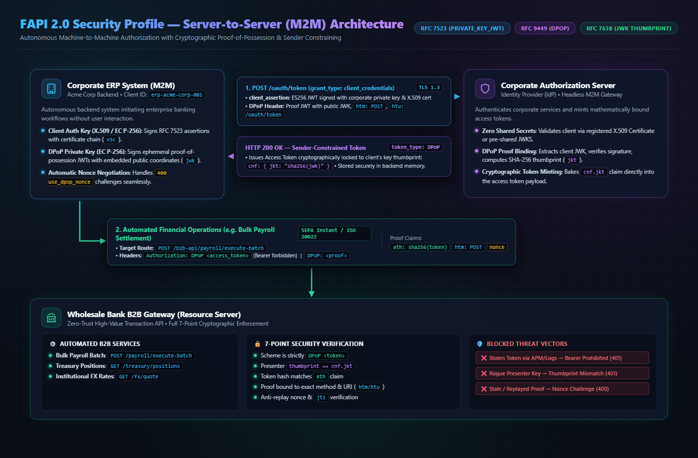
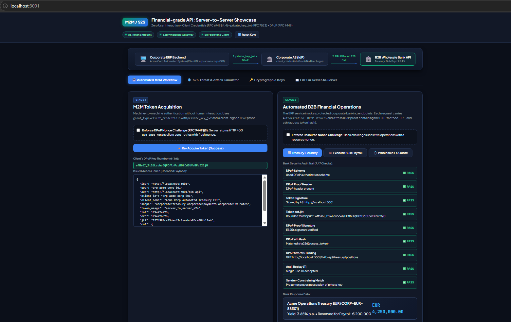

# Beyond mTLS: Why FAPI 2.0 and DPoP Are the Future of Corporate Open Banking (Hands-On Guide)

> *How to replace cumbersome mutual TLS pipelines with application-layer cryptography using RFC 7523, RFC 9449, and FAPI 2.0 for enterprise server-to-server integrations.*

---

## 1. The Corporate Open Banking Dilemma

When Open Banking first emerged under PSD2 and UK Open Banking frameworks, the overwhelming industry focus was on consumer-to-business (C2B) use cases: retail users authorizing a FinTech app to aggregate checking accounts or initiate instant payments using browser redirects and mobile app-to-app handshakes.

However, the real economic volume in commercial banking lies in **Corporate and Wholesale Banking**:
* Automated multi-million-euro treasury liquidity sweeps
* High-volume automated bulk payroll processing (SEPA Instant / ISO 20022)
* Automated foreign exchange (FX) hedging triggered directly from an ERP system (SAP, Oracle, NetSuite)

In these **Server-to-Server (M2M)** architectures, there is no end-user sitting in front of a browser to click "Authorize" or solve a biometric prompt. The corporate backend must communicate directly with the bank’s gateway in an autonomous, zero-trust fashion.

---

## 2. The Traditional Fix: Why Mutual TLS (mTLS) Is Hurting Enterprises

To prevent credentials from leaking and to ensure sender-constraining, banking regulators originally leaned heavily on **Mutual TLS (mTLS)** for client authentication (RFC 8705) and transport-level mutual verification.

While cryptographically sound, mTLS introduces massive operational friction in modern cloud environments:

### A. The Reverse Proxy & Ingress Nightmare
In cloud-native environments (AWS, GCP, Azure, Kubernetes), TLS is almost always terminated at edge layers: Cloudflare, AWS ALB, Kong, or NGINX Ingress controllers. Forwarding client certificate attributes across internal microservices requires complex header injection (`X-Forwarded-Client-Cert`), custom mTLS passthrough configurations, and brittle ingress routing.

### B. The Death of Dual-EKU Certificates (CA/Browser Forum Mandate)
Historically, corporate organizations often attempted to simplify certificate management by deploying certificates carrying dual Extended Key Usage (EKU) flags: both **Server Authentication** (`serverAuth`, OID 1.3.6.1.5.5.7.3.1) and **Client Authentication** (`clientAuth`, OID 1.3.6.1.5.5.7.3.2). 

Under the latest **CA/Browser Forum Baseline Requirements**, public Certificate Authorities (CAs) are strictly prohibited from issuing dual-EKU certificates. As highlighted in security analyses of the mandate, separating TLS server identities from client authentication certificates now forces organizations to manage distinct PKI hierarchies, dramatically multiplying certificate renewal overhead, rotation coordination, and sudden operational outages caused by expired client certs.

Last but not least this type of certificates emitted after march 2027 will expire in only 100 days.

---

## 3. Enter FAPI 2.0: Moving Cryptography to the Application Layer

The **Financial-Grade API 2.0 (FAPI 2.0)** Security Profile by the OpenID Foundation addresses these challenges at the root. Instead of tethering security strictly to the transport pipe (Layer 4/7 boundary), FAPI 2.0 elevates authentication and sender-constraining to the **Application Layer (Layer 7)**.



### The Three Pillars of FAPI 2.0 M2M:

1. **[RFC 7523](https://datatracker.ietf.org/doc/html/rfc7523) (`private_key_jwt`) Client Authentication**:
   Shared client secrets (`client_secret`) are completely eliminated. The corporate ERP signs an authentication JWT using its private Elliptic Curve key (`ES256`). The bank verifies this signature using the client's public JWKS or X.509 certificate. No secrets ever cross the wire.
2. **[RFC 9449](https://datatracker.ietf.org/doc/html/rfc9449) DPoP — Demonstrating Proof-of-Possession**:
   Access tokens are no longer "Bearer" tokens. A stolen token is completely useless to an attacker. When the ERP calls the bank, it creates a real-time signed DPoP proof. The bank validates that the presenter’s public key matches the **cryptographic thumbprint** (`cnf.jkt` per RFC 7638) embedded inside the access token when it was minted.
3. **[RFC 9449](https://datatracker.ietf.org/doc/html/rfc9449#section-8) DPoP Nonce Negotiation**:
   The bank’s gateway can enforce live freshness by returning an `HTTP 400 use_dpop_nonce` challenge. The client instantly refreshes the signature with the server-supplied nonce, preventing offline pre-computation and replayed requests.

---

## 4. Hands-On Lab: Test It Locally in 5 Minutes

To see FAPI 2.0 M2M in action, I built a zero-dependency reference implementation containing a complete Authorization Server, Wholesale Bank Gateway, automated ERP client, and a pre-configured **Bruno API collection**.

If you are not hands-on or you have not time go directly [here](#step-3-m2m-token-exchange-post-oauthtoken) to see the flow described step by step.

### Quick Start: Launching the Demo

Clone the repository and start the server:

```bash
# Clone the repository
git clone https://github.com/dvitali/fapi2.0-demo.git
cd fapi-server-to-server

# Run the automated test suite (Zero external dependencies, 100% native Node.js)
npm test

# Start the interactive server
npm start
```

Open your browser at `http://localhost:3001` to view the built-in dark-mode dashboard:



The dashboard allows you to visually inspect:
* **Stage 1 (Token Acquisition)**: Real-time generation of `client_assertion` and DPoP proof headers.
* **Stage 2 (B2B Financial Operations)**: Instant SEPA payroll batches, treasury accounts, and wholesale FX quotes.
* **7-Point Security Audit**: Inspecting token thumbprints (`cnf.jkt`), access token hashes (`ath`), and method/URI bindings.
* **Live Threat Simulations**: Running simulated attacks (stolen token replay, rogue key injection, and stale nonce bypass) to observe bank defenses in real time.

---

## 5. Step-by-Step API Walkthrough with Bruno

For developers and API architects, I have included an 8-step **Bruno collection** in the `bruno/` directory.

---

### Step 1: Environment Setup (`Local.bru`)

Open Bruno, select **Open Collection**, and choose the `bruno/` folder in the project. Select the **Local** environment:

**Important**: remember to switch Bruno in Developer mode (img/BrunoDevMode.png)


The environment contains:
* `baseUrl`: `http://localhost:3001`
* `clientId`: `erp-acme-corp-bruno`
* `clientCertificatePem`: Self-signed P-256 client certificate
* `clientPrivateKeyPem`: PKCS#8 private key used to sign `client_assertion`
* `dpopPrivateKeyPem`: Private key used for DPoP proofs
* `dpopPublicKeyJwk`: Public JWK coordinates (`x`, `y`) embedded in DPoP headers

---

### Step 2: Discovery and Public JWKS

1. **Request `01 - Auth Server Discovery`** (`GET /.well-known/openid-configuration`):
   Retrieves server metadata verifying support for `private_key_jwt`, `client_credentials`, and `ES256` DPoP signing.
2. **Request `02 - Auth Server Public JWKS`** (`GET /oauth/jwks.json`):
   Fetches the Authorization Server's public EC keys used to sign access tokens.

---

<a id="step-3-m2m-token-exchange-post-oauthtoken"></a>
### Step 3: M2M Token Exchange (`POST /oauth/token`)

This request represents the cryptographic core of FAPI 2.0 Server-to-Server communication. Rather than relying on static shared credentials or transport-level client certificates, the client performs an application-layer authenticated token exchange using standard OAuth 2.0 `grant_type=client_credentials` reinforced with RFC 7523 and RFC 9449:


#### The Complete HTTP Request

```http
POST /oauth/token HTTP/1.1
Host: localhost:3001
Content-Type: application/x-www-form-urlencoded
DPoP: eyJhbGciOiJFUzI1NiIsInR5cCI6ImRwb3Arand0IiwiandrIjp7Imt0eSI6IkVDIiwiY3J2Ijoi...

grant_type=client_credentials
&client_id=erp-acme-corp-bruno
&client_assertion_type=urn%3Aietf%3Aparams%3Aoauth%3Aclient-assertion-type%3Ajwt-bearer
&client_assertion=eyJhbGciOiJFUzI1NiIsInR5cCI6IkpXVCIsIng1YyI6WyJNSUlCaVRDQ...
```

---

#### 1. The Request Header: DPoP Proof (RFC 9449)

Along with the body parameters, the client attaches the HTTP request header: `DPoP: <jwt>`. This DPoP proof is a signed JWT (JSON Web Signature) composed of a **Header** containing the client's public key and a **Payload** binding the proof to the current HTTP request.

##### The DPoP Header & Embedded JWK:
```json
{
  "alg": "ES256",
  "typ": "dpop+jwt",
  "jwk": {
    "kty": "EC",
    "crv": "P-256",
    "x": "W8jW6rX1W6r...",
    "y": "K9zN8mQ1P0a..."
  }
}
```

> **Deep Dive: What is a JWK (JSON Web Key, RFC 7517)?**  
> Historically, cryptographic keys were exchanged using bulky, binary, or legacy formats like PEM files (`-----BEGIN PUBLIC KEY-----` encapsulating ASN.1 DER data), which are cumbersome to parse and manipulate natively in modern web and cloud APIs.  
> A **JWK (JSON Web Key)** is an open IETF standard (RFC 7517) that represents cryptographic keys as clean, native, human-readable **JSON objects**. In DPoP, the client dynamically creates a key pair and embeds its **public key** directly inside the JWT header under the `jwk` parameter. This allows the Authorization Server to verify the signature immediately without needing to pre-register or look up the DPoP key in advance.

Here is the purpose of **every field** in this header:
* **`typ: "dpop+jwt"` (Token Type)**: Explicitly declares that this token is a DPoP proof. Under RFC 9449, this strict typing prevents cross-protocol confusion attacks (e.g., ensuring an attacker cannot repurpose an ID Token or Access Token as a DPoP proof).
* **`alg: "ES256"` (Signature Algorithm)**: Mandated by FAPI 2.0. Enforces the Elliptic Curve Digital Signature Algorithm (ECDSA) using the NIST P-256 curve and SHA-256.
* **`jwk` (JSON Web Key)**: The public key object itself, containing the following properties:
  * **`kty` (Key Type)**: Identifies the cryptographic algorithm family. `"EC"` denotes **Elliptic Curve** cryptography (distinct from `"RSA"` or symmetric `"oct"` keys).
  * **`crv` (Curve Name)**: Specifies the exact cryptographic curve on which the key operates. For `"ES256"`, this is `"P-256"` (also known as NIST prime256v1 or secp256r1), which provides high-speed operations and strong 128-bit cryptographic security.
  * **`x` (X-Coordinate)**: The base64url-encoded affine X-coordinate of the public key point on the elliptic curve.
  * **`y` (Y-Coordinate)**: The base64url-encoded affine Y-coordinate of the public key point on the elliptic curve.
  *(Together, `x` and `y` represent the public point $(X, Y)$ on the curve. Notice that the sensitive private parameter `d` is **never** included, ensuring the private key never leaves the client.)*

> **Key Takeaway**: The Authorization Server hashes this exact canonical `jwk` (RFC 7638) to calculate the **JWK Thumbprint (`jkt`)**. This thumbprint will be stamped into the access token's `cnf.jkt` claim, permanently locking the access token to this specific key!

##### The DPoP Payload (HTTP Method & URL Binding):
```json
{
  "jti": "7f8b9a10-2c3d-4e5f-6a7b-8c9d0e1f2a3b",
  "htm": "POST",
  "htu": "http://localhost:3001/oauth/token",
  "iat": 1700234267
}
```
* **`jti` (JWT ID)**: Unique single-use token identifier to prevent replay attacks.
* **`htm` (HTTP Method)**: Set to `"POST"`, matching the request verb.
* **`htu` (HTTP URI)**: Set to `"http://localhost:3001/oauth/token"`, matching the endpoint URL without query parameters.
* **`iat` (Issued At)**: Timestamp ensuring the proof was minted seconds ago.

This cryptographic binding ensures that even if an attacker intercepts the DPoP proof in flight, they cannot replay it against a different API endpoint or with a different HTTP verb.

---

#### 2. The Request Body: Anatomy of the POST /token Parameters

Every parameter in this payload is purpose-built to eliminate shared secrets and prevent token forgery:

| Parameter | Value | RFC Specification & Security Purpose |
| :--- | :--- | :--- |
| **`grant_type`** | `client_credentials` | **RFC 6749 §4.4**: Specifies the headless, machine-to-machine flow where the client authenticates autonomously without an interactive resource owner (end-user). |
| **`client_id`** | `erp-acme-corp-bruno` | **RFC 6749 §2.2**: The unique client identifier registered with the Authorization Server. Identifies which corporate entity is establishing the session. |
| **`client_assertion_type`** | `urn:ietf:params:oauth:client-assertion-type:jwt-bearer` | **RFC 7523 §2.2**: Informs the Authorization Server that the client is authenticating via an asymmetric cryptographic JWT (`private_key_jwt`), completely replacing traditional plaintext `client_secret` passwords. |
| **`client_assertion`** | `<Compact JWS>` | **RFC 7523 §3**: A digitally signed, tamper-proof JSON Web Signature (JWS) created by the corporate backend using its private key. |

---

#### Dissecting the `client_assertion` JWT

The `client_assertion` is not just a token; it is a legally non-repudiable digital signature proving the client's identity at this exact millisecond. 

In its compact transport format (RFC 7519), it is transmitted as three base64url-encoded strings joined by dots (`<header>.<payload>.<signature>`):

When decoded, here is the **full JWT JSON in clear text**:

```json
{
  "header": {
    "alg": "ES256",
    "typ": "JWT",
    "x5c": [
      "MIIB+DCCAZ+gAwIBAgIUPn/smvl425i/KHR9VhhB7Y+wR9UwCgYIKoZIzj0EAwIwUjEcMBoGA1UEAwwTZXJwLWFjbWUtY29ycC1icnVubzESMBAGA1UECgwJQWNtZSBDb3JwMREwDwYDVQQLDAhUcmVhc3VyeTELMAkGA1UEBhMCSVQwHhcNMjYxMTE3MDkzMTU3WhcNMjcxMTE3MDkzMTU3WjBSMRwwGgYDVQQDDBNlcnAtYWNtZS1jb3JwLWJydW5vMRIwEAYDVQQKDAlBY21lIENvcnAxETAPBgNVBAsMCFRyZWFzdXJ5MQswCQYDVQQGEwJJVDBZMBMGByqGSM49AgEGCCqGSM49AwEHA0IABJ/tFnrg171EYdZ4wFt6DIdSOdDnCaaqy2cW/ecj9AFY9gbiZd7YdVAFjyA0xKqkekniiRbKacXyuCHdlZQgYPOjUzBRMB0GA1UdDgQWBBTtkCzM48Mntg+ckQHlDTNQbSOz/zAfBgNVHSMEGDAWgBTtkCzM48Mntg+ckQHlDTNQbSOz/zAPBgNVHRMBAf8EBTADAQH/MAoGCCqGSM49BAMCA0cAMEQCIHb9VULBUyAiB3rmjp/9zSjD117PCenxU4iJcXANPckMAiB97HCb4m3UB1JZ0E2tV20K9uhFbifAqHRibijNi29zyA=="
    ],
    "x5t#S256": "3cb6c83cccf7a6ee33434d35eb18f26ef554a991"
  },
  "payload": {
    "iss": "erp-acme-corp-bruno",
    "sub": "erp-acme-corp-bruno",
    "aud": "http://localhost:3001/oauth/token",
    "jti": "d3b07384-d113-46fb-9b27-5d3c2174d89a",
    "iat": 1700234267,
    "exp": 1700234567
  },
  "signature": "<base64url-encoded ES256 ECDSA P-1363 signature over header.payload>"
}
```

Now let's examine the purpose of each individual section:

##### 1. The Header:
```json
{
  "alg": "ES256",
  "typ": "JWT",
  "x5c": [
    "MIIBiTCCAS6gAwIBAgIUd..."
  ]
}
```
* **`alg: "ES256"`**: Mandated by FAPI 2.0. Enforces Elliptic Curve Digital Signature Algorithm (ECDSA) using the NIST P-256 curve and SHA-256. Weak legacy algorithms (such as RSA 1024 or insecure HMACs) are explicitly forbidden.
* **`x5c` (X.509 Certificate Chain & Third-Party CA Trust)**: Embeds an array of base64-encoded DER X.509 certificates directly in the JWS header (RFC 7515 §4.1.6). This is where FAPI 2.0 unlocks the full power of a **Third-Party Certification Authority (CA)** or enterprise PKI without any of the network friction of mTLS:
  - **Third-Party CA Certification**: The client does not need to pre-share public keys out-of-band. Instead, the client presents an X.509 certificate issued by a public CA (e.g., DigiCert, Sectigo) or a Qualified Trust Service Provider (QTSP under eIDAS, such as a **QSealC — Qualified Electronic Seal Certificate**).
  - **Dynamic Enterprise Trust Verification**: The Authorization Server validates the certificate chain against its trusted Root Store, verifies certificate revocation via OCSP or CRLs, and checks that the Subject DN (or Organization Identifier / VAT / LEI) matches the caller's `client_id`.
  - **Bypassing the Dual-EKU Mandate**: Unlike mTLS certificates (which are subject to the CA/Browser Forum restriction prohibiting combined `serverAuth` and `clientAuth` in public TLS certificates), the certificate embedded in `x5c` operates at the application layer. It is issued with Key Usage `digitalSignature` (and optionally `nonRepudiation`), completely liberating enterprise PKI from TLS web server baseline constraints.
  - **Alternative (Pre-shared JWKS)**: In architectures that do not operate an X.509 PKI, the client simply omits `x5c` and includes a `kid` referencing its public key in a pre-registered JWKS or Open Banking directory.

##### 2. The Payload:
```json
{
  "iss": "erp-acme-corp-bruno",
  "sub": "erp-acme-corp-bruno",
  "aud": "http://localhost:3001/oauth/token",
  "jti": "d3b07384-d113-46fb-9b27-5d3c2174d89a",
  "exp": 1700234567,
  "iat": 1700234267
}
```
* **`iss` (Issuer)**: Must match the `client_id`. Proves that the corporate entity claims authorship of the assertion.
* **`sub` (Subject)**: Must match the `client_id`. Identifies the principal being authenticated.
* **`aud` (Audience)**: The exact URL of the Authorization Server's `/oauth/token` endpoint. **Crucial Security Check**: If an attacker intercepts this assertion, they cannot replay it against another bank or endpoint because the audience will not match.
* **`jti` (JWT ID)**: A cryptographically unique UUIDv4. The Authorization Server caches observed `jti` values within the validity window to guarantee **single-use execution** and prevent replay attacks.
* **`exp` (Expiration)**: Epoch timestamp typically set to 3–5 minutes from creation. Assertions are short-lived proofs, not long-term credentials.
* **`iat` (Issued At)**: Prevents clock skew exploitation and ensures freshness.

---

#### Server Verification & Sender-Constrained Token Issuance

Upon receiving the request, the Authorization Server executes the following checks:
1. **Assertion Signature**: Validates the `client_assertion` signature using the public key from the `x5c` certificate or pre-registered JWKS.
2. **Assertion Constraints**: Verifies `aud` matches `/oauth/token`, `exp` has not lapsed, and `jti` has not been seen before.
3. **DPoP Proof Verification**: Verifies the signature of the `DPoP` header using the embedded `jwk`.
4. **Calculates JWK Thumbprint (`jkt`)**: Computes the canonical SHA-256 thumbprint (RFC 7638) of the client's DPoP public key
5. **Issues the Bound Access Token**:
   The Authorization Server returns an HTTP `200 OK` response with `token_type: "DPoP"`:
   ```json
   {
     "access_token": "eyJhbGciOiJFUzI1NiIsInR5cCI6ImF0K2p3dCIsImtpZCI6ImFzLXMycy1rZXkt...<compact-jwt>",
     "token_type": "DPoP",
     "expires_in": 1800,
     "scope": "corporate:treasury corporate:payments corporate:fx-rates",
     "dpop_jkt": "0zonDsDMoL5ir42kpFIm16JmXTELx7JKWk9jWGRILrs"
   }
   ```

---

#### Dissecting the Sender-Constrained Access Token (`at+jwt`)

In transport format (RFC 9068), the minted `access_token` is a compact JWT comprising three base64url-encoded segments joined by dots

When decoded, here is the **full access token JSON in clear text**:

```json
{
  "header": {
    "typ": "at+jwt",
    "alg": "ES256",
    "kid": "as-s2s-key-m3k8a1b"
  },
  "payload": {
    "iss": "http://localhost:3001",
    "sub": "erp-acme-corp-bruno",
    "aud": "http://localhost:3001/b2b-api",
    "client_id": "erp-acme-corp-bruno",
    "client_name": "Acme Corp Treasury ERP",
    "scope": "corporate:treasury corporate:payments corporate:fx-rates",
    "token_usage": "server_to_server_m2m",
    "iat": 1700234267,
    "exp": 1700236067,
    "jti": "8f3b2a1c-9d4e-4f5a-8b7c-1d2e3f4a5b6c",
    "cnf": {
      "jkt": "0zonDsDMoL5ir42kpFIm16JmXTELx7JKWk9jWGRILrs"
    }
  },
  "signature": "<base64url-encoded ES256 ECDSA signature issued by Authorization Server>"
}
```

##### Field-by-Field Breakdown of the Access Token:

###### Header Claims:
* **`typ: "at+jwt"`**: Mandated by **RFC 9068 §2.1** (JWT Profile for OAuth 2.0 Access Tokens). Explicitly identifies this token as an Access Token, preventing cross-protocol token substitution attacks (an attacker cannot pass this token where an ID Token or client assertion is expected).
* **`alg: "ES256"`**: Enforces the NIST P-256 Elliptic Curve algorithm with SHA-256, complying with FAPI 2.0 cryptographic mandates.
* **`kid` (Key ID)**: References the public key in the Authorization Server's JWKS (`GET /oauth/jwks.json`). The Resource Server uses this ID to locate the exact public key needed to verify the token signature.

###### Payload Claims:
* **`iss` (Issuer)**: The canonical URL of the Authorization Server (`http://localhost:3001`). Confirms which authority issued the credential.
* **`sub` (Subject)**: Identifies the principal of the token, which in M2M client credentials flows is the `client_id` (`erp-acme-corp-bruno`).
* **`aud` (Audience)**: `http://localhost:3001/b2b-api`. **Crucial Security Boundary**: The token can only be accepted by the bank's B2B Resource Server. If an attacker intercepts this token, they cannot replay it against other internal or third-party bank APIs.
* **`client_id` & `client_name`**: The formal OAuth client identifier and human-readable corporate entity description for auditing and regulatory reporting.
* **`scope`**: The specific corporate banking capabilities granted to this session (`corporate:treasury corporate:payments corporate:fx-rates`).
* **`token_usage`**: Set to `"server_to_server_m2m"`, designating this as a machine-to-machine session operating without interactive end-user participation.
* **`iat` (Issued At)**: The epoch timestamp when the token was created.
* **`exp` (Expiration)**: The epoch timestamp when the token expires (set to `iat + 1800`, providing a short 30-minute validity window).
* **`jti` (JWT ID)**: A cryptographically unique UUIDv4 identifying this specific access token for logging, tracking, and revocation.
* **`cnf.jkt` (Confirmation Claim — The Sender-Constraint Lock)**:
  This is the defining security feature of **FAPI 2.0 and RFC 9449 §6.1**
  During token exchange (Step 3), the Authorization Server extracted the client's public EC key from the `DPoP` header, computed its canonical SHA-256 thumbprint, and stamped it permanently into this `cnf.jkt` claim.

  > **How the Bank Gateway Validates This (The Companion Header Match):**  
  > Whenever the client makes an API call to the bank (as you will see in Step 4), it sends **two headers simultaneously in the exact same HTTP request**:
  > 1. `Authorization: DPoP <access_token>` (which holds this `cnf.jkt` claim).
  > 2. `DPoP: <fresh_proof_jwt>` (the companion header containing the client's public key in `header.jwk` and signed with the client's private key).
  >
  > The API Gateway validates them as an inseparable pair: it computes the SHA-256 thumbprint of the public key inside the incoming `DPoP` header and verifies that it **strictly matches the `cnf.jkt` stamped inside the access token**, while also verifying the DPoP proof's signature.
  
  **Why this matters**: The access token is no longer a vulnerable "bearer" credential. Even if an attacker steals this access token from a reverse proxy cache or server log, **they cannot use it alone**. Any API gateway enforcing FAPI 2.0 will reject the request unless the caller proves possession of the matching private key by presenting a valid, freshly signed `DPoP` companion header!

---

### Step 4: Executing B2B Transactions (e.g., Bulk Payroll)

Open **`05 - B2B Bulk Payroll (DPoP)`** (`POST /b2b-api/payroll/execute-batch`):

```json
{
  "totalAmount": 184500.00,
  "employeeCount": 45
}
```

#### The Cryptographic Handshake in Bruno:
When you click **Send** on request `05 - B2B Bulk Payroll (DPoP)` in Bruno, the pre-request script executes the following cryptographic steps:
1. **Reads Keys from Environment (`Local.bru`)**:
   - `accessToken`: The token minted during Step 03, bound to `cnf.jkt`.
   - `dpopPrivateKeyPem`: The client's EC P-256 private key.
   - `dpopPublicKeyJwk`: The public key coordinates:
     ```json
     {
       "kty": "EC",
       "crv": "P-256",
       "x": "XMzmFV2MEVvfYZFR_NRIku0h7dWHheln4TG1bH92YTs",
       "y": "nw6x7l5yHXQAsVbngvJBHRiymBwQzUdqNzsrooON5Vw"
     }
     ```
2. **Calculates the Access Token Hash (`ath`)**:
   $$\text{ath} = \text{base64url}(\text{SHA-256}(\text{accessToken}))$$
   This cryptographically binds the proof specifically to this access token, preventing an attacker from pairing a stolen proof with a different token.
3. **Signs a Fresh DPoP Proof**:
   - **Header**: Contains `alg: "ES256"`, `typ: "dpop+jwt"`, and the embedded `jwk` public coordinates.
   - **Payload**: Contains a fresh UUID `jti`, `htm: "POST"`, `htu: "http://localhost:3001/b2b-api/payroll/execute-batch"`, `iat: <now>`, and the computed `ath`.
   - **Signature**: Signed via ECDSA (`ES256`) using `dpopPrivateKeyPem`.
4. **Sends the HTTP Request**:
   ```http
   POST /b2b-api/payroll/execute-batch HTTP/1.1
   Host: localhost:3001
   Authorization: DPoP eyJhbGciOiJFUzI1NiIsInR5cCI6IkpXVCJ9...
   DPoP: eyJhbGciOiJFUzI1NiIsInR5cCI6ImRwb3Arand0Iiwiand...
   Content-Type: application/json

   {
     "totalAmount": 184500.00,
     "employeeCount": 45
   }
   ```

---

#### What Happens Inside the Bank Gateway:
When the request hits `http://localhost:3001/b2b-api/payroll/execute-batch`, the bank gateway executes the middleware (`B2BBankResourceServer.authenticateRequest` in `lib/b2b-bank-api.js`). 

Before releasing €184,500.00 onto the clearing network, the gateway performs **8 rigorous cryptographic checks**:

```
[Incoming Request]
        │
        ├─► 1. Check Scheme ────────► Must be 'Authorization: DPoP <token>' (Bearer rejected)
        ├─► 2. Verify Access Token ──► Verify AS signature via JWKS & check 'exp'
        ├─► 3. Inspect cnf.jkt ──────► Extract token-bound thumbprint claim
        ├─► 4. Verify DPoP Signature ► Verify ES256 signature using embedded public 'jwk'
        ├─► 5. Validate htm / htu ───► Must match exact verb (POST) & URI (/b2b-api/payroll/...)
        ├─► 6. Validate Token Hash ──► Compute sha256(token) & match proof's 'ath'
        ├─► 7. Anti-Replay Check ────► Proof 'jti' must be unique and not consumed
        │
        ▼
   [CRITICAL SENDER-CONSTRAINT CHECK]
   Compute canonical SHA-256 thumbprint of presenter's JWK:
         presenter_jkt = base64url(SHA256(canonical_jwk))
         
   Verify: presenter_jkt === tokenPayload.cnf.jkt ?
        │
        ├── NO  ──► 401 Unauthorized (SENDER-CONSTRAINT VIOLATION)
        └── YES ──► 200 OK: Process SEPA Instant Credit Transfer
```

##### Detailed Walkthrough with Bruno Data:

1. **Authorization Scheme Check**:
   The gateway checks the `Authorization` header. If it detects `Bearer`, the gateway aborts with `401 Unauthorized` (`"Invalid token scheme 'Bearer'. FAPI 2.0 requires 'DPoP <access_token>'"`). Bruno sends `Authorization: DPoP ...` $\rightarrow$ **PASS**.
2. **Access Token Verification**:
   The gateway verifies the access token's ES256 signature using the Authorization Server's public key (retrieved from `/oauth/jwks`). It decodes the claims:
   ```json
   {
     "iss": "http://localhost:3001",
     "sub": "erp-acme-corp-bruno",
     "client_id": "erp-acme-corp-bruno",
     "client_name": "Acme Corp Treasury ERP",
     "scope": "corporate:treasury corporate:payments corporate:fx-rates",
     "cnf": {
       "jkt": "0zonDsDMoL5ir42kpFIm16JmXTELx7JKWk9jWGRILrs"
     },
     "exp": 1700237867
   }
   ```
   The signature is valid and `exp` has not expired $\rightarrow$ **PASS**.
3. **Sender-Constraint Claim Presence (`cnf.jkt`)**:
   The gateway confirms the presence of `tokenPayload.cnf.jkt`. If missing, the token is deemed insecure bearer and rejected $\rightarrow$ **PASS**.
4. **DPoP Proof Signature Verification**:
   The gateway parses the `DPoP` header. It extracts the client's public key coordinates (`x` and `y`) from `header.jwk` and mathematically verifies that the DPoP signature was created by the corresponding private key $\rightarrow$ **PASS**.
5. **Endpoint Binding Validation (`htm` & `htu`)**:
   The gateway checks that `proof.htm === "POST"` and `proof.htu === "http://localhost:3001/b2b-api/payroll/execute-batch"`. If an attacker stole the proof and attempted to use it for `GET /b2b-api/treasury/positions`, verification would fail $\rightarrow$ **PASS**.
6. **Access Token Hash Validation (`ath`)**:
   The gateway hashes the presented access token: `sha256Base64Url(token)`. It confirms this equals `proof.ath`. This guarantees that this DPoP proof cannot be attached to any other access token $\rightarrow$ **PASS**.
7. **Anti-Replay Protection (`jti`)**:
   The gateway queries its cache `seenDpopJti.has(proof.jti)`. Since this UUID was generated fresh by Bruno, it is accepted and added to the cache $\rightarrow$ **PASS**.
8. **The Sender-Constraining Proof (`presenter_jkt === cnf.jkt`)**:
   This is the cornerstone of FAPI 2.0 security. The gateway computes the RFC 7638 SHA-256 thumbprint of the presenter's `jwk`:
   Because Bruno used the exact keypair registered in `Local.bru`, both thumbprints equal `"0zonDsDMoL5ir42kpFIm16JmXTELx7JKWk9jWGRILrs"`. The gateway has cryptographic proof that the presenter holds the private key that originally requested the token! $\rightarrow$ **PASS**.

---

#### The Successful Bank Response in Bruno:

All 8 checkpoints pass. The gateway authorizes the business transaction, creates the batch record, and dispatches the funds. Bruno receives `200 OK` with the complete execution audit trail:

```json
{
  "status": "success",
  "payrollBatch": {
    "batchId": "BATCH-PAYROLL-M3K9A7B",
    "executedBy": "Acme Corp Treasury ERP",
    "sourceAccount": "CORP-EUR-88301",
    "totalAmount": 184500,
    "currency": "EUR",
    "employeeCount": 45,
    "timestamp": "2026-11-18T17:42:15.123Z",
    "clearingNetwork": "SEPA Instant Credit Transfer (SCT Inst)",
    "status": "SETTLED"
  },
  "fapiSecurityAudit": {
    "timestamp": "2026-11-18T17:42:15.120Z",
    "method": "POST",
    "url": "http://localhost:3001/b2b-api/payroll/execute-batch",
    "checks": [
      { "name": "DPoP Scheme", "status": "PASS", "details": "Used DPoP authorization scheme" },
      { "name": "DPoP Proof Header", "status": "PASS", "details": "DPoP header present" },
      { "name": "Token Signature", "status": "PASS", "details": "Signed by AS: http://localhost:3001" },
      { "name": "Token cnf.jkt", "status": "PASS", "details": "Bound to thumbprint: 0zonDsDMoL5ir42kpFIm16JmXTELx7JKWk9jWGRILrs" },
      { "name": "DPoP Proof Signature", "status": "PASS", "details": "ES256 signature verified" },
      { "name": "DPoP ath Hash", "status": "PASS", "details": "Matched sha256(access_token)" },
      { "name": "DPoP htm/htu Binding", "status": "PASS", "details": "POST http://localhost:3001/b2b-api/payroll/execute-batch" },
      { "name": "Anti-Replay JTI", "status": "PASS", "details": "Single-use JTI accepted" },
      { "name": "Sender-Constraining Match", "status": "PASS", "details": "Presenter proves possession of private key" }
    ]
  }
}
```

---

### Step 5: Testing Threat Mitigations

The Bruno collection includes automated attack tests to prove that FAPI 2.0 security works:

#### Threat 1: Replay of an Exfiltrated Bearer Token (`07 - Threat 1 - Replay Bearer`)
* **Scenario**: An attacker intercepts or copies the raw access token from APM logs or network proxies and attempts to use it with `Authorization: Bearer <token>`.
* **Result**: **`401 Unauthorized`**. The bank explicitly requires the `DPoP` scheme. Stolen tokens cannot be used alone.

#### Threat 2: Rogue Presenter Key Attack (`08 - Threat 2 - Rogue DPoP Key`)
* **Scenario**: The attacker steals the access token, generates their own rogue EC keypair, and crafts a mathematically valid DPoP proof signed with their own key.
* **Result**: **`401 Unauthorized`**. The bank detects that the presenter's key thumbprint does not match the token's `cnf.jkt` claim:
  ```json
  {
    "error": "invalid_dpop_proof",
    "error_description": "SENDER-CONSTRAINT VIOLATION: Presenter key thumbprint does not match token bound cnf.jkt"
  }
  ```

---

## 6. Architecture Comparison: mTLS vs. FAPI 2.0 DPoP

| Feature | Legacy Mutual TLS (mTLS) | FAPI 2.0 (DPoP + Private Key JWT) |
| :--- | :--- | :--- |
| **Security Layer** | Transport Layer (Layer 4/TLS) | Application Layer (Layer 7/HTTP) |
| **Edge Termination** | Breaks when TLS terminates at CDN/WAF/ALB | Survives any reverse proxy or API gateway |
| **Public CA Mandates** | Impassioned by CA/B Forum Dual-EKU ban | Independent of CA constraints (pure JWK / x5c) |
| **Client Secrets** | Often mixed with shared secrets | Zero shared secrets (`private_key_jwt` ES256) |
| **Token Theft Impact** | Safe if mTLS client cert required | Mathematically useless without private DPoP key |
| **Implementation Overhead** | High (PKI distribution, proxy passthroughs) | Low (Standard JSON, HTTP headers, & Web Crypto) |

---

## 7. Reference Guide: Demystifying Certificates in Banking (QSealC vs. QWAC vs. Standard SSL vs. DPoP)

When engineering European Open Banking and corporate treasury APIs (under **eIDAS Regulation EU 910/2014**, **ETSI TS 119 495**, and **Berlin Group openFinance**), teams often struggle with the distinct roles of **QWAC**, **QSealC**, standard **SSL/TLS**, and **DPoP**.

They operate at different layers of the OSI model and serve entirely different legal and cryptographic purposes.

### The Intuitive Analogy

| Technology | Real-World Analogy | What it Actually Protects |
| :--- | :--- | :--- |
| **Standard SSL / TLS** | A generic tinted armored car. | Protects data in transit from eavesdroppers, but anyone with a domain can obtain one. |
| **QWAC** (*Qualified Web Auth Cert*) | An armored car driven by a **vetted corporate courier carrying a diplomatic passport**. | Authenticates the server/organization establishing the transport tunnel during the TLS handshake. |
| **QSealC** (*Qualified Electronic Seal*) | The **notarized, tamper-evident corporate signature and wax seal** on the legal contract inside the car. | Provides legal non-repudiation and integrity for the payload itself (payment order, JWT assertion), even after the armored car arrives and is unloaded. |
| **DPoP** (*RFC 9449 Proof*) | A **single-use security badge** generated dynamically for the current session. | Prevents access token theft and replay; completely independent of legal identities or CAs. |

---

### Comparative Architecture Matrix

| Feature | Standard SSL / TLS | QWAC (Qualified Web Auth) | QSealC (Qualified Electronic Seal) | DPoP (RFC 9449) |
| :--- | :--- | :--- | :--- | :--- |
| **OSI Layer** | **Layer 4** (Transport / TLS) | **Layer 4** (Transport / TLS / mTLS) | **Layer 7** (Application / Payload) | **Layer 7** (HTTP Request Header) |
| **Primary Purpose** | Wire encryption in transit | **Mutual Channel Authentication** (mTLS) | **Payload Non-Repudiation & Integrity** | **Sender-Constraining Access Tokens** |
| **Key Usage / EKU** | `serverAuth`, `clientAuth` | `serverAuth`, `clientAuth` | `digitalSignature`, `nonRepudiation` | None (pure cryptographic keypair) |
| **Trust Anchor** | Commercial CAs (Let's Encrypt, DigiCert) | Qualified Trust Service Provider (**QTSP**) on EU Trusted List | Qualified Trust Service Provider (**QTSP**) on EU Trusted List | Self-generated client keypair (no CA required) |
| **Survives TLS Termination?** | ❌ No | ❌ **No** (terminates at WAF/load balancer) | ✅ **Yes** (travels inside the signed message) | ✅ **Yes** (travels inside HTTP headers) |
| **Legal Status (eIDAS)** | None | Proves legal entity operating the endpoint | **Legal presumption of integrity and authenticity** (Art. 35) | Technical proof-of-possession |
| **Typical Usage in Banking** | Public HTTPS browsing | Bank-to-ERP mTLS transport tunnel | `client_assertion` (`x5c`), ISO 20022 `pain.001` signatures | `DPoP` proof header & `cnf.jkt` binding |

---

### Deep Dive: Transport Layer (QWAC) vs. Application Layer (QSealC)

The architectural limitation of **QWAC** stems from **TLS Termination at Enterprise Edges**:


1. **The TLS Termination Trap (Why QWAC is Not Enough):**
   * When an ERP connects via mTLS using a QWAC, the cryptographic session ends at the bank's external reverse proxy or Cloud WAF.
   * Between the gateway and internal core banking ledger, the payload travels through internal microservices and message queues.
   * If an internal bug or rogue administrator alters the destination IBAN after TLS termination, the bank **has no cryptographic proof** that the payload came altered from the client or was altered internally.
   * **QWAC provides zero non-repudiation once the TLS handshake terminates.**

2. **The Application Layer Solution (QSealC):**
   * The ERP signs the payload directly (e.g., JWS signature on the `client_assertion` or XML-DSig on the payment order) using its **QSealC private key**.
   * The digital signature and the certificate chain travel inside the HTTP request body or headers (`x5c`).
   * This signature travels intact through every reverse proxy, gateway, and message broker, and is stored permanently in the bank's ledger archives.
   * Under **eIDAS Regulation (EU) No 910/2014 Article 35**, a Qualified Electronic Seal enjoys the legal presumption of integrity of the data and correctness of the origin.

---

### How They Fit Together in FAPI 2.0 & Corporate Banking

In modern wholesale and corporate banking implementations (such as enterprise **Corporate Banking API-as-a-Service** platforms):

1. **Client Authentication at `/token` (RFC 7523 + QSealC):**
   * The ERP authenticates without shared secrets using `private_key_jwt`.
   * It embeds its corporate certificate (or QSealC) in the `x5c` header of the `client_assertion`.
   * The bank's Authorization Server verifies the chain against EU QTSP trust lists, authenticating the corporate entity at Layer 7.
2. **Access Token Sender-Constraining (DPoP):**
   * The ERP uses a lightweight, ephemeral EC keypair (`P-256`) to sign `DPoP` proofs.
   * The Bank binds the token to the thumbprint of this key (`cnf.jkt`).
   * **Important**: DPoP does *not* use or require the QSealC or QWAC key. It is an ephemeral, session-bound keypair managed directly by the HTTP client (like Bruno or an ERP microservice) to prevent token theft.
3. **Transaction Authorization (The "Corporate Seal" Approach):**
   * In corporate B2B banking, high-volume automated batches (such as payrolls of €184,500.00) cannot pause for interactive employee SMS/push OTPs (SCA).
   * Instead, banks accept the **Corporate Seal (QSealC)** applied directly to the payment batch. Under PSD2 regulatory standards (RTS Article 32), an electronic seal provides the legal equivalent of Strong Customer Authentication for automated corporate channels.

---

## 8. Conclusion: The Path Forward for B2B Banking

The era of relying exclusively on transport-level mutual TLS for enterprise banking is coming to an end. As cloud native architectures become the global standard, and as regulatory frameworks evolve to prevent brittle infrastructure, **FAPI 2.0 + DPoP** offers the ideal balance:
* **Uncompromising cryptographic security** demanded by wholesale financial institutions.
* **Operational simplicity** that cloud engineers, DevOps teams, and corporate ERP integrators can deploy seamlessly across any standard network infrastructure.

If you are designing modern B2B Open Banking APIs, treasury gateways, or ERP financial integrations, make FAPI 2.0 your baseline architecture today.

---

### Resources & Source Code
* **Demo Project GitHub Repository**: [`https://github.com/your-username/fapi-server-to-server`](https://github.com/your-username/fapi-server-to-server)
* **OpenID Foundation**: [FAPI 2.0 Security Profile Specifications](https://openid.net/specs/fapi-2_0-security-profile.html)
* **IETF RFC 9449**: [OAuth 2.0 Demonstrating Proof-of-Possession (DPoP)](https://datatracker.ietf.org/doc/html/rfc9449)
* **ETSI TS 119 495**: [Electronic Signatures and Infrastructures (ESI); Sector Specific Requirements; Qualified Certificate Profiles and TSP Accreditations under PSD2](https://www.etsi.org/deliver/etsi_ts/119400_119499/119495/)
* **eIDAS Regulation (EU) No 910/2014**: [Electronic Identification and Trust Services for Electronic Transactions in the Internal Market](https://eur-lex.europa.eu/legal-content/EN/TXT/?uri=uriserv%3AOJ.L_.2014.257.01.0073.01.ENG)
* **CA/Browser Forum Mandate**: [End of Dual-EKU Certificates](https://www.encryptionconsulting.com/ca-browser-forum-mandate/)
